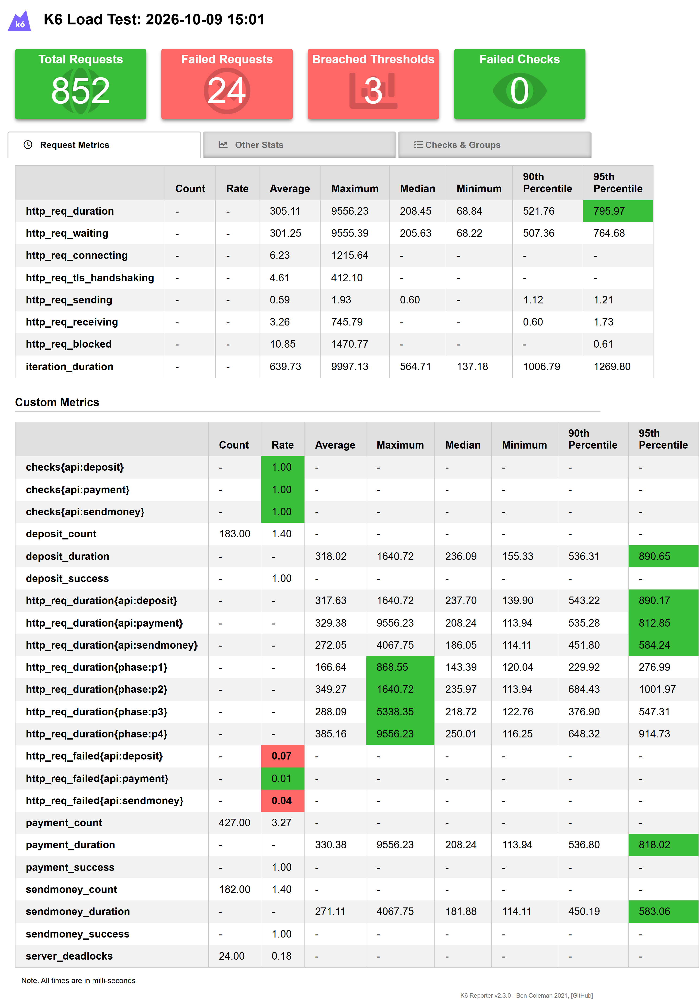
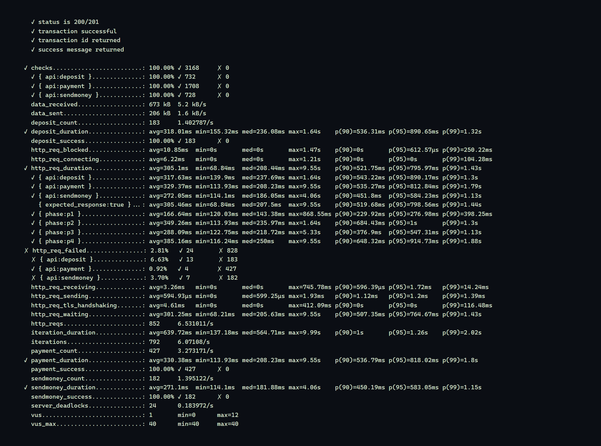
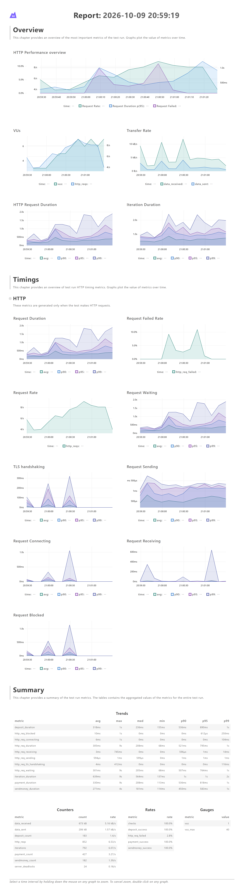

# DMoney Transaction Performance Test (k6)

A [k6](https://k6.io/) performance test that simulates **2 minutes of DMoney
transaction activity** for six users across four 30-second phases, then compares
the three transaction APIs — **Deposit**, **Send Money**, and **Payment** — on
response time, throughput and failure rate, and reports the performance
degradation seen as the concurrent workload grows phase by phase.

> Assignment: *Performance Testing (Batch 19)* — Road to SDET.
> System under test: DMoney REST API (`http://localhost:5000` locally, or the
> hosted `https://dmoney.roadtocareer.net`).

---

## Table of contents

- [Scenario](#scenario)
- [What the test does](#what-the-test-does)
- [Transaction flow (4 phases)](#transaction-flow-4-phases)
- [Assertions (checks)](#assertions-checks)
- [Thresholds](#thresholds)
- [How to run](#how-to-run)
- [Reports & screenshots](#reports--screenshots)
- [Results & analysis](#results--analysis)
- [How authentication is handled](#how-authentication-is-handled)
- [DMoney business rules discovered](#dmoney-business-rules-discovered)
- [Project structure](#project-structure)

---

## Scenario

Six test users take part:

| User | Role | Part they play |
|------|------|----------------|
| Agent 1    | Agent    | deposits cash to customers; pays a merchant |
| Agent 2    | Agent    | deposits cash to customers; pays a merchant |
| Customer 1 | Customer | sends money, makes payments |
| Customer 2 | Customer | sends money, makes payments |
| Merchant 1 | Merchant | receives payments |
| Merchant 2 | Merchant | receives payments |

Three APIs are exercised:

- `POST /transaction/deposit` — Agent → Customer cash-in
- `POST /transaction/sendmoney` — Customer → Customer transfer
- `POST /transaction/payment` — Customer/Agent → Merchant payment

---

## What the test does

1. **`setup()` (runs once, before the timed phases):**
   - logs in the privileged `admin` and `system` accounts,
   - **creates and activates the 6 test users**,
   - **mints each initiating user's own JWT** (each user authenticates with their
     own credentials — see [authentication](#how-authentication-is-handled)),
   - funds the two agents from `SYSTEM`, and funds the two customers from Agent 1.
2. **13 flows run as 13 independent k6 scenarios.** Each flow is a
   `constant-arrival-rate` scenario that starts at its phase boundary and runs
   for the full 30-second window, so every flow inside a phase executes
   **concurrently and keeps firing** for that whole window.
3. Because later phases run more flows at once, **total throughput climbs phase
   by phase** — which is exactly the "workload change" we measure degradation
   against.
4. Every response is validated with four [checks](#assertions-checks) and timed
   into per-API metrics.
5. `handleSummary()` writes an HTML report, a JSON summary and a plain-text
   summary; a k6 web-dashboard HTML (time-series) is produced alongside.

---

## Transaction flow (4 phases)

Each flow fires at `RATE` transactions/second (default **2**) for its 30-second
window.

| Phase (time) | Concurrent flows | APIs active |
|---|---|---|
| **Phase 1** (0–30s)  | C1→C2 send · C2→M1 pay | sendmoney, payment |
| **Phase 2** (30–60s) | C2→C1 send · A1→C2 deposit · C1→M1 pay | sendmoney, deposit, payment |
| **Phase 3** (60–90s) | A1→C1 deposit · A2→C2 deposit · C1→C2 send · C2→M2 pay | deposit, sendmoney, payment |
| **Phase 4** (90–120s)| A1→M1 pay · A2→M2 pay · C1→M1 pay · C2→M2 pay | payment (×4) |

Concurrency rises **2 → 3 → 4 → 4** flows, and the per-second request volume
rises with it.

---

## Assertions (checks)

Every transaction response is validated with four checks, tagged per API:

| Check | What it verifies |
|---|---|
| `status is 200/201` | expected HTTP status code |
| `transaction successful` | 2xx **and** the body carries no error/failure message |
| `transaction id returned` | a `trnxId` is present in the response |
| `success message returned` | the expected success message (`Deposit…` / `Send money…` / `Payment successful`) |

---

## Thresholds

Configured in [`dmoney-load-test.js`](dmoney-load-test.js) exactly as the
assignment requires, **plus separate thresholds per API**:

```js
// global
http_req_failed      : ['rate<0.01']    // < 1% failed requests
http_req_duration    : ['p(95)<1000']   // p95 under 1000 ms
checks               : ['rate>0.99']    // > 99% of checks pass

// per API (via request tags) — Deposit / Send Money / Payment
'http_req_duration{api:deposit}'   : ['p(95)<1000']
'http_req_duration{api:sendmoney}' : ['p(95)<1000']
'http_req_duration{api:payment}'   : ['p(95)<1000']
'http_req_failed{api:deposit}'     : ['rate<0.01']
'http_req_failed{api:sendmoney}'   : ['rate<0.01']
'http_req_failed{api:payment}'     : ['rate<0.01']
'checks{api:deposit}'              : ['rate>0.99']
'checks{api:sendmoney}'            : ['rate>0.99']
'checks{api:payment}'              : ['rate>0.99']

// custom per-API trends
deposit_duration / sendmoney_duration / payment_duration : ['p(95)<1000']
```

Per-phase sub-metrics (`http_req_duration{phase:p1..p4}`) are also surfaced so
response-time degradation can be read phase by phase.

---

## How to run

### Prerequisites

- **k6** ≥ v0.50 — install with `winget install GrafanaLabs.k6`, `choco install k6`,
  or download from <https://github.com/grafana/k6/releases>.
- A reachable DMoney API. Defaults target `https://dmoney.roadtocareer.net`;
  point at your local server with `-e BASE_URL=http://localhost:5000`.

### Run the full 2-minute test

```bash
k6 run dmoney-load-test.js
```

### With the time-series web dashboard exported to HTML

```bash
# PowerShell
$env:K6_WEB_DASHBOARD="true"; $env:K6_WEB_DASHBOARD_EXPORT="reports/dashboard.html"
k6 run dmoney-load-test.js
```

### Useful overrides (`-e KEY=value`)

| Key | Default | Meaning |
|---|---|---|
| `BASE_URL` | `https://dmoney.roadtocareer.net` | API base URL |
| `SECRET_KEY` | `ROADTOSDET` | `X-AUTH-SECRET-KEY` partner key |
| `RATE` | `2` | transactions/second per flow |
| `PHASE_SECONDS` | `30` | length of each phase (set `3` for a quick smoke run) |
| `JITTER` | `0.6` | max think-time (s) added before each request |
| `DEADLOCK_RETRIES` | `3` | client retries on a transient server deadlock |
| `DEBUG` | — | set `1` to print the body of any failed transaction |

Quick smoke run (all four phases compressed into ~12s):

```bash
k6 run -e PHASE_SECONDS=3 dmoney-load-test.js
```

---

## Reports & screenshots

After a run these are generated:

- `reports/summary.html` — the k6-reporter HTML report
- `reports/dashboard.html` — k6 web-dashboard time-series
- `reports/summary.json` / `reports/summary.txt` — machine- and human-readable summaries

Regenerate the README screenshots from the reports with:

```bash
node tools/screenshot.mjs
```

### HTML report



### End-of-test metrics



### Time-series (per-phase degradation)



---

## Results & analysis

<!-- RESULTS_START -->
**Run profile:** 2-minute run, 4 × 30s phases, 2 transactions/s per flow,
`JITTER=0.6`, deadlock-retry ×3, target `https://dmoney.roadtocareer.net`.
**852 HTTP requests · 792 transactions · ~6.5 req/s.**

### Threshold results

| Scope | Threshold | Result | Verdict |
|---|---|---|:--:|
| Global | `http_req_failed` < 1% | **2.81%** | ❌ |
| Global | `p(95)` < 1000 ms | **796 ms** | ✅ |
| Global | `checks` > 99% | **100%** | ✅ |
| Deposit | `p(95)` < 1000 ms · failed < 1% · checks > 99% | 890 ms · 6.63% · 100% | ✅ / ❌ / ✅ |
| Send Money | `p(95)` < 1000 ms · failed < 1% · checks > 99% | 584 ms · 3.70% · 100% | ✅ / ❌ / ✅ |
| Payment | `p(95)` < 1000 ms · failed < 1% · checks > 99% | 813 ms · 0.92% · 100% | ✅ / ✅ / ✅ |

Everything passes **except the `http_req_failed` thresholds**, which are breached
**entirely by transient server-side deadlocks** — see [analysis](#analysis).

### API comparison (response time, throughput, failure rate)

| API | Requests | Throughput | avg | p90 | p95 | p99 | max | Checks (success) | HTTP failed |
|---|--:|--:|--:|--:|--:|--:|--:|--:|--:|
| **Deposit**    | 183 | 1.40/s | 318 ms | 543 ms | 890 ms | 1.30 s | 1.64 s | 100% | 6.63% |
| **Send Money** | 182 | 1.40/s | 272 ms | 452 ms | 584 ms | 1.13 s | 4.06 s | 100% | 3.70% |
| **Payment**    | 427 | 3.27/s | 329 ms | 535 ms | 813 ms | 1.79 s | 9.55 s | 100% | 0.92% |
| **Overall**    | 852 | 6.53/s | 305 ms | 522 ms | 796 ms | 1.43 s | 9.55 s | 100% | 2.81% |

### Response-time degradation as workload grows

Concurrency rises 2 → 3 → 4 → 4 flows across the phases; response time rises
with it (`http_req_duration` tagged per phase):

| Phase | Time | Concurrent flows | avg | p95 | p99 | max |
|---|---|:--:|--:|--:|--:|--:|
| **1** | 0–30s   | 2 | **167 ms** | 277 ms | 398 ms | 869 ms |
| **2** | 30–60s  | 3 | 349 ms | 1.00 s | 1.30 s | 1.64 s |
| **3** | 60–90s  | 4 | 288 ms | 547 ms | 1.13 s | 5.33 s |
| **4** | 90–120s | 4 | **385 ms** | 915 ms | 1.88 s | **9.55 s** |

### Analysis

- **Response time.** All three APIs keep **p95 under the 1000 ms target**
  (Send Money fastest at 584 ms; Deposit and Payment heavier at ~810–890 ms).
  The **tails grow sharply under load**, though — the worst Payment call in the
  peak phase took 9.55 s.
- **Throughput.** ~6.5 req/s sustained. Payment carries the most volume (427
  requests, 3.27/s) because 6 of the 13 flows are payments. Aggregate throughput
  climbs phase-by-phase as more flows overlap.
- **Failure rate.** **Transaction-level success is 100%** — every `checks`
  assertion passed, i.e. every transaction ultimately succeeded. The **2.81%
  `http_req_failed` is made up entirely of transient MySQL deadlocks** (HTTP 500,
  *"Deadlock found when trying to get lock; try restarting transaction"*) when
  concurrent requests write the **same account row**. Deposit (6.63%) and Send
  Money (3.70%) deadlock most because they write the shared **customer** rows
  (C1/C2 take part in many overlapping flows); Payment (0.92%) is lowest as it
  mostly credits merchants.
- **Degradation.** From phase 1 to phase 4 the average response time **more than
  doubles** (167 ms → 385 ms) and the **tail explodes** (max 869 ms → 9.55 s);
  the deadlock rate also rises with concurrency. This is a clear **server-side
  concurrency bottleneck**, not a client limitation.
- **Threshold verdict & mitigation.** The p95 and checks thresholds pass globally
  and per API. The `< 1%` failed-request threshold is **breached by transient
  deadlocks only**. The client already mitigates them with an automatic retry (as
  the DB error advises), which is why transaction success stays 100% — but the
  first 500 of each still registers in `http_req_failed`. Across repeated runs the
  deadlock rate **tracked server load (0.7%–2.8%)**, confirming it is a property
  of the server under concurrent same-account writes rather than of the test.

> **SQA takeaway:** DMoney meets its latency and correctness targets at this load,
> but its transaction engine does **not serialise concurrent same-account writes
> cleanly** — it leaks MySQL deadlocks that surface as 5xx errors and tail-latency
> blow-ups as concurrency increases. That is the headline reliability risk to fix
> (e.g. consistent lock ordering / row-level retry on the server side).
<!-- RESULTS_END -->

---

## How authentication is handled

The assignment requires that **each user authenticates with their own
credentials**. DMoney enforces two rules that shape how this is done:

1. **Every non-admin login requires an e-mail OTP** (`otpRequired: true`).
2. **Every `/transaction/*` call must be initiated from the token owner's own
   account** — an admin or system token is rejected with
   *"you can only initiate transactions from your own account."*

So each transaction genuinely needs the acting user's **own** JWT. Because these
are throwaway test accounts we create ourselves, `setup()` mints each token
end-to-end without a human reading e-mail:

```
login(email,password)          → OTP generated for this test account
admin reads that account's OTP  → GET /user/search/email/:email
POST /user/verify-otp           → the user's own JWT
```

Tokens are minted once in `setup()` (before the timed phases) and reused by the
VUs for the 2-minute run, so authentication never pollutes the response-time
metrics. OTP handling lives in [`lib/auth.js`](lib/auth.js).

---

## DMoney business rules discovered

Found by probing the API; the test is designed to stay inside these limits so it
measures the APIs rather than tripping over business validation:

| Rule | Value |
|---|---|
| Login auth | admin/system: direct token; others: e-mail OTP |
| Transaction initiator | must own the `from_account` (token identity is checked) |
| `SYSTEM` deposits | only to **Agent** accounts (not customers/merchants) |
| Agent → Customer deposit | min **10**, max **10,000** per deposit |
| Customer wallet balance | capped at **10,000** (balance-based; refills as they spend) |
| Send money | min **10**, flat **5 tk** fee on sender |
| Payment | min **10**, flat **5 tk** fee on sender; merchants have no receive cap |
| New users | created `pending`; must be `PATCH /user/update/:id {status:active}` |

---

## Project structure

```
k6/
├── dmoney-load-test.js   # main test: scenarios, thresholds, setup(), 13 flows, handleSummary
├── config.js             # base URL, secret key, users, amounts, load profile (all -e overridable)
├── lib/
│   ├── auth.js           # login, user create/activate, OTP token minting, funding
│   ├── transactions.js   # one tagged + checked transaction runner (with deadlock retry)
│   └── metrics.js        # custom per-API Trend/Counter/Rate metrics
├── tools/
│   └── screenshot.mjs    # renders the reports to PNGs for this README
├── reports/              # generated HTML / JSON / text reports
├── screenshots/          # images embedded above
└── package.json          # npm run test / test:dashboard shortcuts
```
